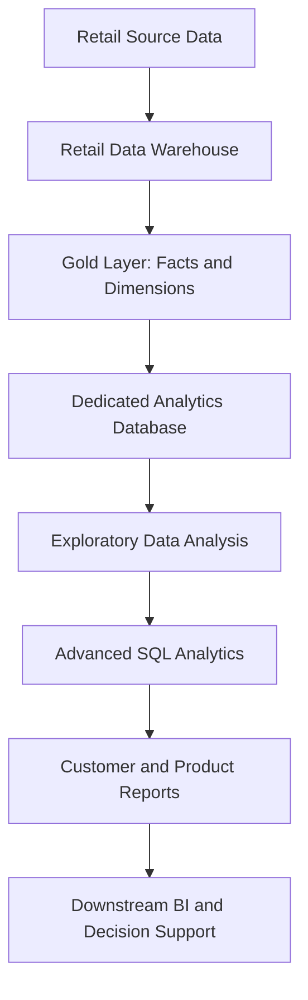

# Retail Data Analytics | Exploratory & Advanced SQL Analysis

  

## Project Overview

This project is an end-to-end SQL-based retail analytics study designed to transform business-ready data into meaningful insights. It builds on a previously developed Retail Data Warehouse, using its Gold Layer fact and dimension datasets as the foundation for analytical reporting.

A dedicated analytics database was created to separate analytical workloads from the original data warehouse. The project progresses from exploratory data analysis and foundational business metrics to advanced analytical techniques, customer segmentation, and consolidated business reports.

## Project Objectives

- Understand the structure, characteristics, and coverage of retail data.
- Develop reusable business metrics and KPI views across fact datasets.
- Evaluate sales trends, customer behavior, and product performance.
- Analyze the impact of promotions and returns on net sales.
- Apply advanced T-SQL techniques to support business decision-making.
- Prepare consolidated customer and product reports for downstream business intelligence.

## Data Architecture

The analytical database uses cleaned, integrated, and business-ready data from the Gold Layer of the preceding data warehouse project. Fact and dimension datasets provide the foundation for analytical joins and reporting.



The original warehouse implements a Bronze, Silver, and Gold architecture. This repository focuses on the subsequent analytics phase rather than repeating the ETL implementation.

## 1. Exploratory Data Analysis (EDA)

| Analysis | Description | Business purpose |
| --- | --- | --- |
| Database Exploration | Inspect database objects, table structures, columns, and metadata. | Understand the analytical environment. |
| Dimension Exploration | Examine descriptive attributes and distinct dimension values. | Understand available business entities and categories. |
| Date Range Exploration | Identify the earliest and latest order dates and relevant temporal coverage. | Establish the observation period for analysis. |
| Measures Exploration | Calculate foundational metrics across fact datasets and consolidate measures into reusable SQL views. | Establish consistent KPI definitions and baseline performance. |
| Magnitude Analysis | Aggregate measures across relevant dimensions using GROUP BY. | Identify how business activity is distributed across entities and categories. |

## 2. Advanced Data Analytics

### Ranking Analysis

Identify top-performing entities across relevant dimensions, including:

- Top 10 customers by spending.
- Top 5 customers by order volume.
- Top 5 products by order volume.
- Product category and other dimension-level rankings.

**Business value:** Identify high-value customers, popular products, and key contributors to business performance.

### Change Over Time Analysis

Analyze monthly changes in sales, quantities sold, customer activity, and other relevant measures.

**Business value:** Understand temporal trends, identify fluctuations, and support period-based performance evaluation.

### Net Sales Analysis

Integrate sales, promotion, and return data to evaluate sales after discounts and refunds.

Conceptual calculation:

```text
Net Sales = Gross Sales - Discount Amount - Refund Amount
```

The calculation depends on the source definitions of sales, discounts, and refunds, and requires compatible transaction granularity to avoid duplicate amounts or double-counting adjustments.

**Business value:** Provide a more meaningful view of sales performance after commercial adjustments.

### Cumulative Analysis

Calculate running totals of monthly sales and other applicable measures to evaluate how performance accumulates over time.

**Business value:** Track progress within reporting periods and understand cumulative business performance.

### Performance Analysis

Evaluate business measures against relevant historical or comparative benchmarks to identify improvements and declines.

**Business value:** Support performance monitoring and highlight areas requiring further investigation.

### Part-to-Whole Analysis

Measure the contribution of individual business segments to an overall total.

```text
Contribution (%) = Segment Measure / Total Measure × 100
```

**Business value:** Understand the relative importance of products, categories, customers, and other applicable business segments.

### Customer Segmentation

Group customers based on behavioral characteristics such as customer lifespan and order frequency.

Customer lifespan represents the elapsed time between a customer's first and last recorded orders. Segmentation helps distinguish different purchasing patterns within the observed dataset.

**Business value:** Support customer profiling, retention analysis, and targeted business strategies.

## 3. Business Reporting

### Customer Report

Consolidate customer-level attributes and purchasing metrics into a structured analytical report. The report provides a foundation for understanding customer value, purchasing behavior, and customer segments.

### Product Report

Consolidate product-level attributes and sales performance measures into a structured analytical report. The report supports product comparisons, portfolio evaluation, and the identification of key contributors to sales.

These reports provide reusable analytical outputs for downstream dashboards and business intelligence tools such as Power BI.

## SQL Techniques and Technologies

| Category | Technologies and concepts |
| --- | --- |
| Database platform | Microsoft SQL Server |
| Query language | Transact-SQL (T-SQL) |
| Data modeling | Fact tables, dimension tables, dimensional modeling |
| Data exploration | Metadata inspection, DISTINCT, date range analysis |
| Aggregation | GROUP BY, SUM, COUNT, AVG, MIN, MAX |
| Advanced SQL | Joins, CTEs, subqueries, window functions, ranking functions |
| Time-series analysis | Date-based grouping, running totals, period comparisons |
| Business logic | KPI calculations, conditional logic, segmentation, contribution analysis |
| Reusability | SQL views and structured analytical reports |

## Data Quality and Analytical Considerations

Reliable analytics depends on the consistency of the underlying warehouse data. The following considerations are important when interpreting the results:

- Verify the grain of each fact dataset before joining sales, promotions, and returns.
- Distinguish unique orders from order-line counts when calculating order metrics.
- Confirm whether source sales amounts already include discounts before applying adjustments.
- Validate customer segmentation thresholds against the observed data distribution and business objectives.
- Interpret customer lifespan within the available observation period; it does not necessarily represent the complete customer relationship.

## Project Deliverables

- A dedicated retail analytics database populated with Gold Layer datasets.
- Exploratory SQL analysis scripts.
- Foundational KPI and measure views.
- Advanced analytical SQL queries.
- Customer segmentation analysis.
- Consolidated customer and product reports.

## Suggested Repository Structure

```text
Retail-Data-Analytics/
├── datasets/                  # Gold Layer datasets or sample data
├── scripts/
│   ├── 01_database_exploration.sql
│   ├── 02_dimension_exploration.sql
│   ├── 03_date_range_exploration.sql
│   ├── 04_measures_exploration.sql
│   ├── 05_magnitude_analysis.sql
│   ├── 06_ranking_analysis.sql
│   ├── 07_change_over_time_analysis.sql
│   ├── 08_net_sales_analysis.sql
│   ├── 09_cumulative_analysis.sql
│   ├── 10_performance_analysis.sql
│   ├── 11_part_to_whole_analysis.sql
│   └── 12_customer_segmentation.sql
├── reports/
│   ├── customer_report.sql
│   └── product_report.sql
└── README.md
```

The structure above is a suggested organization; filenames and directories may differ from the actual implementation.

## Getting Started

1. Set up a Microsoft SQL Server environment.
2. Create a dedicated analytics database.
3. Import the required Gold Layer fact and dimension datasets from the Retail Data Warehouse project.
4. Verify table names, data types, and relationships against the analytical scripts.
5. Execute the exploratory analysis scripts, followed by the advanced analysis and reporting scripts, respecting any view dependencies.

## Related Project

**Retail Data Warehouse** — the upstream project responsible for raw data ingestion, ETL automation, data cleansing, dimensional modeling, clustered indexing, and date-based table partitioning.

Together, these projects demonstrate the complete journey from raw retail data to business-ready analytical insights.

## Conclusion

This project demonstrates a structured approach to retail data analytics using SQL Server, combining exploratory analysis, advanced SQL techniques, business metric development, and analytical reporting. It highlights the ability to translate relational data into reusable analytical outputs that support business intelligence and data-driven decision-making.
