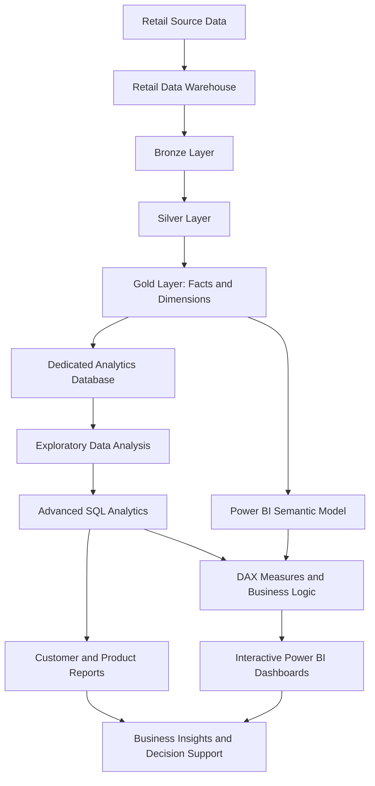
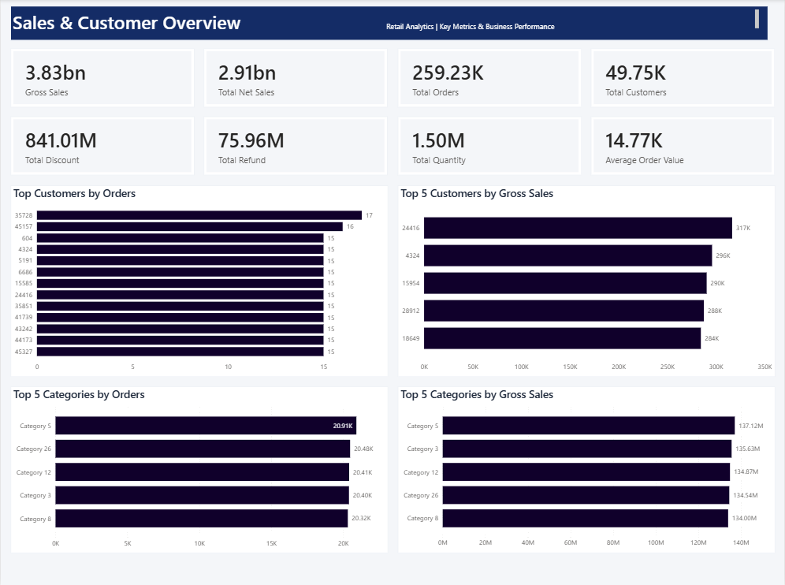
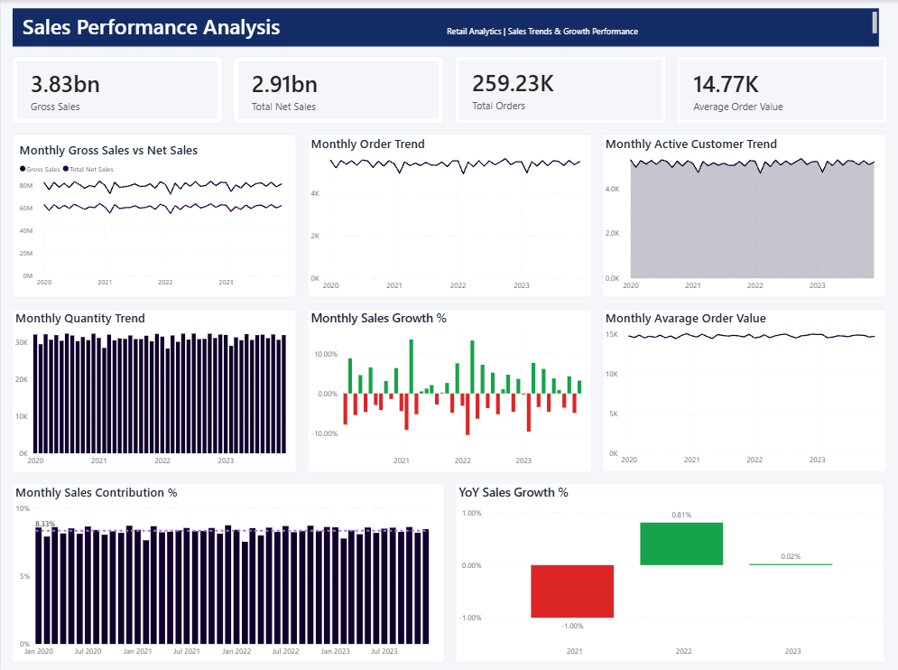
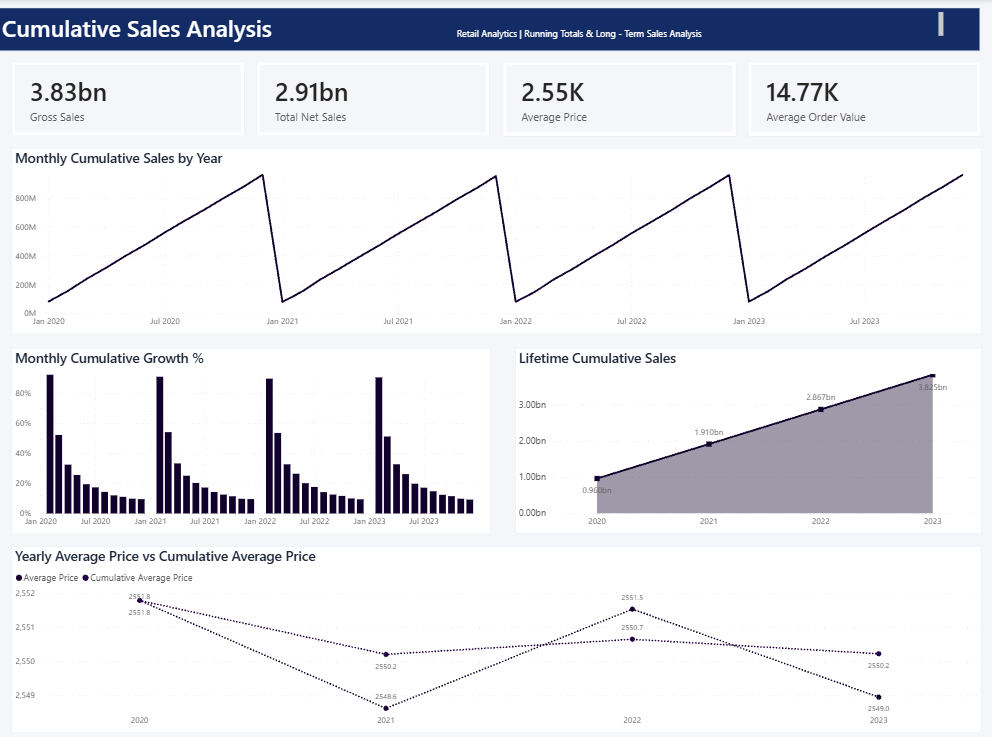
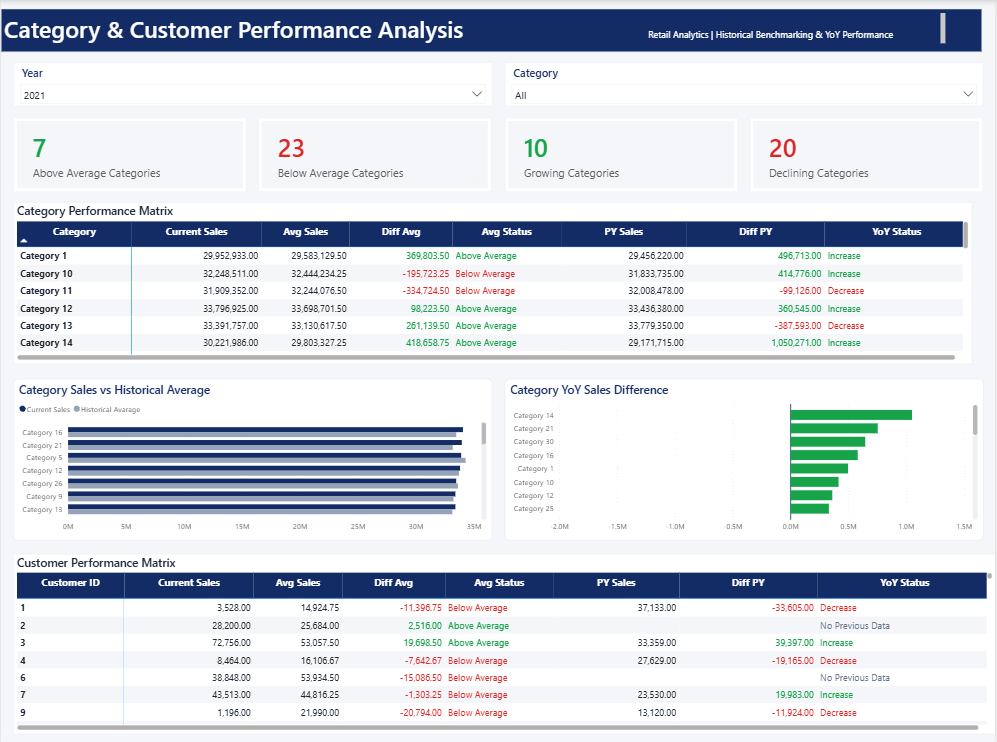
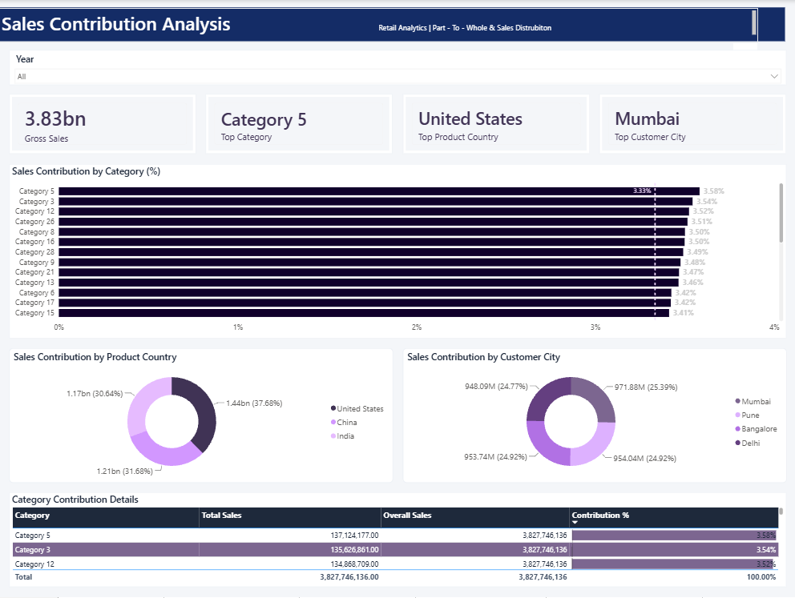
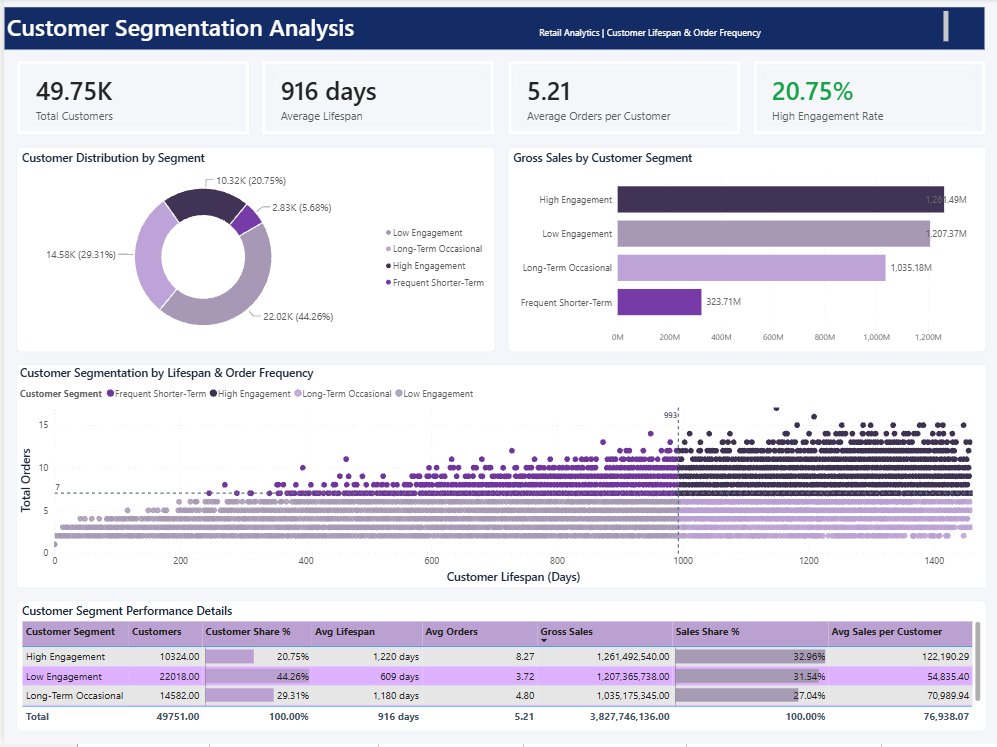

# Retail Data Analytics | End-to-End SQL & Power BI Project


## Project Overview

This project is an end-to-end retail data analytics and business intelligence solution designed to transform business-ready data into meaningful and actionable insights using **Microsoft SQL Server, T-SQL, Power BI, and DAX**.

The project builds on a previously developed Retail Data Warehouse, utilizing its Gold Layer fact and dimension datasets as the foundation for analytical reporting.

A dedicated analytics database was created to separate analytical workloads from the original data warehouse. The project progresses from exploratory data analysis and foundational business metrics to advanced SQL analytics, customer segmentation, consolidated business reports, and interactive Power BI dashboards.

The main objective is to demonstrate the complete analytical workflow, from structured warehouse data to business intelligence and data-driven decision support.

## Project Highlights

| Metric | Result |
| --- | ---: |
| Gross Sales | 3.83 Billion |
| Net Sales | 2.91 Billion |
| Total Customers | 49,751 |
| Total Orders | 259,233 |
| Total Quantity Sold | 1.50 Million |
| Total Discounts | 841.01 Million |
| Total Refunds | 75.96 Million |
| Average Order Value | 14.77 Thousand |
| Average Customer Lifespan | 916 Days |
| Average Orders per Customer | 5.21 |
| High Engagement Customer Rate | 20.75% |
| Power BI Report Pages | 7 |

## Project Objectives

- Understand the structure, characteristics, and coverage of retail data.
- Develop reusable business metrics and KPI views across fact datasets.
- Evaluate sales trends, customer behavior, and product performance.
- Analyze the impact of promotions and returns on net sales.
- Apply advanced T-SQL techniques to support business decision-making.
- Perform customer segmentation using data-driven thresholds.
- Develop consolidated customer and product reports.
- Translate SQL-based analytical calculations into DAX measures.
- Design a dimensional semantic model in Power BI.
- Develop interactive dashboards to communicate analytical findings.

## Data Architecture

The analytical database uses cleaned, integrated, and business-ready data from the Gold Layer of the preceding Retail Data Warehouse project.

Fact and dimension datasets provide the foundation for analytical joins, KPI calculations, advanced analytics, and business intelligence reporting.



The original warehouse implements a Bronze, Silver, and Gold architecture. This repository focuses on the subsequent analytics and business intelligence phases rather than repeating the ETL implementation.

## 1. Exploratory Data Analysis (EDA)

| Analysis | Description | Business Purpose |
| --- | --- | --- |
| Database Exploration | Inspect database objects, table structures, columns, and metadata. | Understand the analytical environment. |
| Dimension Exploration | Examine descriptive attributes and distinct dimension values. | Understand available business entities and categories. |
| Date Range Exploration | Identify the earliest and latest order dates and temporal coverage. | Establish the observation period. |
| Measures Exploration | Calculate foundational metrics and consolidate measures into reusable SQL views. | Establish consistent KPI definitions. |
| Magnitude Analysis | Aggregate measures across relevant dimensions using GROUP BY. | Understand the distribution of business activity. |

## 2. Advanced Data Analytics

### Ranking Analysis

Identify top-performing entities across relevant dimensions, including:

- Top customers by spending.
- Top customers by order volume.
- Top products by order volume.
- Product category and dimension-level rankings.

**Business Value:** Identify high-value customers, popular products, and key contributors to business performance.

### Change Over Time Analysis

Analyze temporal changes in sales, quantities sold, customer activity, and other business measures.

Analytical techniques include:

- Monthly sales trends.
- Monthly customer activity.
- Monthly order and quantity trends.
- Month-over-Month (MoM) growth.
- Year-over-Year (YoY) growth.
- Monthly contribution to annual sales.

**Business Value:** Understand temporal trends, identify fluctuations, and support period-based performance evaluation.

### Net Sales Analysis

Integrate sales, promotion, and return data to evaluate sales after discounts and refunds.

```text
Net Sales = Gross Sales - Discount Amount - Refund Amount
```

The calculation depends on the source definitions of sales, discounts, and refunds, and requires compatible transaction granularity to avoid duplicate amounts or double-counting adjustments.

**Business Value:** Provide a more meaningful view of sales performance after commercial adjustments.

### Cumulative Analysis

Calculate running totals and cumulative performance measures using SQL window functions.

The analysis includes:

- Monthly cumulative sales within each year.
- Monthly cumulative growth.
- Long-term cumulative sales.
- Annual average product prices.
- Cumulative averages of annual average prices.

**Business Value:** Track progress within reporting periods and understand cumulative business performance.

### Performance Analysis

Evaluate business measures against historical and comparative benchmarks.

The analysis includes:

- Category sales performance against historical averages.
- Customer sales performance against historical averages.
- Previous-year sales comparisons.
- Year-over-Year performance differences.
- Conditional performance classification.

Performance classifications include:

- Above Average
- Below Average
- Average
- Increase
- Decrease
- No Change

**Business Value:** Support performance monitoring and highlight areas requiring further investigation.

### Part-to-Whole Analysis

Measure the contribution of individual business segments to an overall total.

```text
Contribution (%) = Segment Measure / Total Measure × 100
```

Contribution analysis is performed across:

- Product categories.
- Product countries.
- Customer cities.

**Business Value:** Understand the relative importance of different business dimensions and identify key sales contributors.

### Customer Segmentation

Group customers based on purchasing behavior using two primary variables:

- Customer purchasing lifespan.
- Total number of distinct orders.

Customer lifespan represents the elapsed time between a customer's first and last recorded orders.

```text
Customer Lifespan = Last Order Date - First Order Date
```

Percentile analysis was performed using the SQL `PERCENTILE_CONT()` function to examine customer lifespan and order frequency distributions before defining segmentation thresholds.

The selected thresholds are:

| Variable | Threshold |
| --- | ---: |
| Customer Lifespan | 993 Days |
| Total Orders | 7 Orders |

Customers are classified into four behavioral segments:

| Customer Segment | Lifespan | Total Orders |
| --- | --- | --- |
| High Engagement | ≥ 993 Days | ≥ 7 |
| Long-Term Occasional | ≥ 993 Days | < 7 |
| Frequent Shorter-Term | < 993 Days | ≥ 7 |
| Low Engagement | < 993 Days | < 7 |

**Business Value:** Support customer profiling, purchasing behavior analysis, and the development of targeted customer engagement strategies.

## 3. Business Reporting

### Customer Report

Consolidate customer-level attributes and purchasing metrics into a structured analytical report.

The report provides a foundation for understanding customer value, purchasing behavior, and customer segments.

### Product Report

Consolidate product-level attributes and sales performance measures into a structured analytical report.

The report supports product comparisons, portfolio evaluation, and the identification of key contributors to sales.

These reports provide reusable analytical outputs for downstream business intelligence applications.

## 4. Power BI Dashboard

The Power BI report transforms SQL-based analytical findings into interactive visualizations using a dimensional data model, DAX calculations, and business-oriented reporting techniques.

The report consists of **seven analytical pages**, each addressing a specific business area.

### Download the Power BI Report

[Download Power BI Dashboard (.pbix)](04-dashboard/dashboard.pbix)

The Power BI file is approximately 42 MB and is managed using Git Large File Storage (Git LFS).

Microsoft Power BI Desktop is required to open and interact with the report.

### 4.1 Sales & Customer Overview



**Objective:** Provide a high-level overview of retail business performance and identify top-performing customers and product categories.

**Key Features:**

- Gross sales and net sales KPIs.
- Total customers and total orders.
- Total discounts and refunds.
- Total quantity sold.
- Average order value.
- Customer rankings by sales and order volume.
- Product category rankings.

**Business Value:** Enable stakeholders to quickly evaluate overall business performance and identify major sales contributors.

### 4.2 Geographical Sales Analysis


**Objective:** Evaluate the geographical distribution of sales and refunds across customer cities and product countries.

**Key Features:**

- Gross sales by customer city.
- Total refunds by customer city.
- Gross sales by product country.
- Total refunds by product country.
- Geographical performance comparisons using treemaps.

**Business Value:** Understand geographical sales distribution and identify differences in commercial performance across geographical dimensions.

### 4.3 Sales Performance Analysis



**Objective:** Analyze changes in sales performance and customer activity over time.

**Key Features:**

- Monthly gross sales and net sales trends.
- Monthly order trends.
- Monthly customer activity.
- Monthly quantity trends.
- Monthly average order value.
- Month-over-Month sales growth.
- Year-over-Year sales growth.
- Monthly contribution to annual sales.

**Business Value:** Identify changes in business performance, monitor growth, and evaluate temporal purchasing patterns.

### 4.4 Cumulative Sales Analysis



**Objective:** Evaluate how sales performance accumulates over time.

**Key Features:**

- Monthly cumulative sales by year.
- Monthly cumulative growth.
- Long-term cumulative sales.
- Annual average product prices.
- Cumulative average of annual average prices.

**Business Value:** Monitor cumulative business performance and evaluate long-term sales development.

### 4.5 Category & Customer Performance Analysis



**Objective:** Compare category and customer performance against historical averages and previous-year results.

**Key Features:**

- Above-average and below-average category KPIs.
- Growing and declining category KPIs.
- Category performance matrices.
- Historical average sales comparisons.
- Year-over-Year sales differences.
- Customer-level performance matrices.
- Conditional formatting for performance classification.
- Interactive year and category filters.

**Business Value:** Identify outperforming and underperforming business entities and support comparative performance evaluation.

### 4.6 Sales Contribution Analysis



**Objective:** Evaluate the relative contribution of product categories, product countries, and customer cities to overall sales.

**Key Features:**

- Product category sales contribution.
- Product country sales distribution.
- Customer city sales distribution.
- Top-performing category, product country, and customer city.
- Detailed contribution tables.
- Percentage-based performance comparisons.
- Interactive year filtering.

**Business Value:** Identify the most significant contributors to total sales and evaluate sales concentration across business dimensions.

### 4.7 Customer Segmentation Analysis



**Objective:** Analyze customer purchasing behavior and financial contribution using lifespan and order frequency-based segmentation.

**Key Features:**

- Total customer count.
- Average customer lifespan.
- Average orders per customer.
- High Engagement customer rate.
- Customer distribution by segment.
- Gross sales by customer segment.
- Customer segmentation scatter chart.
- Lifespan and order frequency threshold reference lines.
- Detailed customer segment performance table.
- Average sales per customer.

**Business Value:** Understand customer purchasing patterns, identify high-value customer groups, and support targeted engagement strategies.

## 5. Key Business Insights

### Overall Sales Performance

- The dataset contains approximately 3.83 billion in gross sales.
- Net sales amount to approximately 2.91 billion after discounts and refunds.
- The business recorded 259,233 distinct orders from 49,751 purchasing customers.
- The average order value is approximately 14.77 thousand.

### Geographical Sales Distribution

- Mumbai represents the largest customer-city sales contribution, accounting for approximately 25.39% of gross sales.
- Sales are relatively evenly distributed across Mumbai, Pune, Bangalore, and Delhi.
- Products associated with the United States account for approximately 37.68% of gross sales, followed by China and India.

### Product Category Contribution

- Category 5 is the highest-contributing product category, generating approximately 137.12 million in gross sales.
- Its contribution represents approximately 3.58% of overall gross sales.
- Sales are relatively distributed across product categories rather than being heavily concentrated in a single category.

### Customer Segmentation Insights

| Customer Segment | Customer Share | Gross Sales Share |
| --- | ---: | ---: |
| High Engagement | 20.75% | 32.96% |
| Low Engagement | 44.26% | 31.54% |
| Long-Term Occasional | 29.31% | 27.04% |
| Frequent Shorter-Term | 5.68% | 8.46% |

- **High Engagement:** Represents only 20.75% of customers but generates approximately 32.96% of gross sales. This segment has the highest average sales per customer, at approximately 122.19 thousand.

- **Frequent Shorter-Term:** Represents 5.68% of customers while contributing approximately 8.46% of gross sales. Its relatively high order frequency suggests potential for longer-term customer engagement.

- **Long-Term Occasional:** Represents 29.31% of customers, with an average purchasing lifespan of 1,180 days and an average of 4.80 orders.

- **Low Engagement:** Represents the largest customer segment at 44.26% of the customer base. This group may provide opportunities for initiatives aimed at increasing purchasing frequency.

These findings describe observed purchasing behavior and sales contribution. They do not establish customer profitability, churn probability, or the effectiveness of future marketing campaigns.

## 6. Power BI Data Modeling & DAX

A dimensional semantic model was developed in Power BI using Gold Layer fact and dimension datasets.

The model supports consistent filtering, reusable business measures, and analytical reporting across multiple business dimensions.

### Data Modeling Techniques

- Fact and dimension relationships.
- Star schema modeling.
- One-to-many relationships.
- Relationship-based filter propagation.
- Dedicated date dimension.
- Customer segmentation calculated table.
- Consistent business metric definitions.

### DAX Techniques

| Category | Functions and Concepts |
| --- | --- |
| Aggregation | SUM, AVERAGE, COUNT, DISTINCTCOUNT |
| Iterators | SUMX, AVERAGEX |
| Filter Context | CALCULATE, FILTER, ALL, REMOVEFILTERS |
| Time Intelligence | DATEADD, SAMEPERIODLASTYEAR |
| Calculated Tables | SUMMARIZE, ADDCOLUMNS, CALENDAR |
| Conditional Logic | SWITCH, IF |
| Ranking | TOPN |
| Relationship Navigation | RELATED |
| Safe Calculations | DIVIDE, COALESCE |
| Variables | VAR, RETURN |
| Date Calculations | DATEDIFF, YEAR, MONTH |

SQL-based analytical calculations were translated into DAX measures to support interactive reporting. Selected calculations were cross-validated against SQL Server results to improve consistency between the analytical database and Power BI.

## 7. Technologies & Skills

| Category | Technologies and Concepts |
| --- | --- |
| Database Platform | Microsoft SQL Server |
| Query Language | Transact-SQL (T-SQL) |
| Business Intelligence | Microsoft Power BI Desktop |
| Analytical Language | DAX |
| Data Modeling | Star Schema, Fact Tables, Dimension Tables |
| Data Exploration | Metadata Inspection, DISTINCT, Date Range Analysis |
| Advanced SQL | Joins, CTEs, Subqueries, Window Functions |
| Statistical Analysis | Percentile Analysis, Data-Driven Segmentation |
| Time-Series Analysis | MoM, YoY, Running Totals, Cumulative Analysis |
| Business Analytics | KPI Development, Ranking, Performance Analysis |
| Customer Analytics | Customer Profiling, Behavioral Segmentation |
| Data Visualization | Interactive Dashboards, Scatter Charts, Treemaps, Matrices |
| Version Control | Git, GitHub, Git LFS |
| Development Tools | SQL Server Management Studio, Visual Studio Code |

## 8. Data Quality and Analytical Considerations

Reliable analytics depends on the consistency of the underlying warehouse data.

The following considerations are important when interpreting the results:

- Verify the grain of each fact dataset before joining sales, promotions, and returns.
- Distinguish unique orders from order-line counts when calculating order metrics.
- Recognize that distinct order counts may not be additive across product categories.
- Confirm whether source sales amounts already include discounts before applying adjustments.
- Investigate inconsistencies between recorded payment amounts and calculated sales amounts before using payment data for financial reconciliation.
- Validate customer segmentation thresholds against observed data distributions and business objectives.
- Interpret customer lifespan within the available observation period rather than as the complete customer relationship.
- Recognize that customer segmentation is calculated from the available purchasing history and is refreshed when the underlying model is refreshed.
- Account for the incomplete 2024 reporting period when performing annual growth and historical benchmark comparisons.
- Retain available 2024 transactions in descriptive analyses where appropriate.
- Interpret product country as a product-related geographical attribute rather than a confirmed sales destination.
- Consider Power BI scatter chart sampling and overlapping data points when interpreting individual customer distributions.

The reported financial values represent analytical calculations based on the available dataset and should not be interpreted as audited financial statements.

## 9. Repository Structure

```text
RetailAnalytics/
│
├── 01-datasets/
│   └── Gold Layer fact and dimension datasets
│
├── 02-docs/
│   └── Project documentation
│
├── 03-scripts/
│   └── SQL exploration, advanced analytics and reporting scripts
│
├── 04-dashboard/
│   ├── dashboard.pbix
│   ├── sales_customer_ranking_dashboard.png
│   ├── geographical_sales_dashboard.png
│   ├── sales_trends_dashboard.png
│   ├── cumulative_sales_dashboard.png
│   ├── category_customer_performance_dashboard.png
│   ├── part_to_whole_dashboard.png
│   └── customer_segmentation_dashboard.png
│
├── .gitattributes
├── LICENSE
└── README.md
```

## 10. Project Deliverables

- Dedicated retail analytics database populated with Gold Layer datasets.
- Exploratory SQL analysis scripts.
- Reusable KPI and measure views.
- Advanced analytical SQL queries.
- Customer segmentation analysis.
- Consolidated customer and product reports.
- Power BI dimensional semantic model.
- DAX measures and calculated tables.
- Seven interactive Power BI report pages.
- Power BI project file and dashboard screenshots.
- Business insights and analytical documentation.

## 11. Getting Started

### SQL Server

1. Set up a Microsoft SQL Server environment.
2. Create a dedicated analytics database.
3. Import the required Gold Layer fact and dimension datasets from the `01-datasets` directory.
4. Verify table names, schemas, data types, and relationships against the analytical scripts.
5. Execute the exploratory analysis scripts.
6. Execute the advanced analysis and reporting scripts, respecting any view dependencies.

### Power BI

1. Install Microsoft Power BI Desktop.
2. Download the [Power BI Dashboard](04-dashboard/dashboard.pbix).
3. Open the PBIX file using Power BI Desktop.
4. Explore the report pages and interactive visualizations.
5. Review the data model, calculated tables, and DAX measures.

The report was developed using a local SQL Server environment. Refreshing the underlying data may require updating the SQL Server connection settings and configuring access to the analytical database.

### Clone the Repository

Git LFS is required to retrieve the full Power BI file when cloning the repository.

```bash
git lfs install
git clone https://github.com/Esteadh/RetailAnalytics.git
cd RetailAnalytics
git lfs pull
```

## 12. Related Project

### Retail Data Warehouse

The upstream Retail Data Warehouse project is responsible for:

- Raw data ingestion.
- ETL automation.
- Data cleansing and standardization.
- Bronze, Silver, and Gold architecture.
- Dimensional data modeling.
- Clustered indexing.
- Date-based table partitioning.

Together, these projects demonstrate the complete journey from raw retail data to business-ready analytical insights and interactive business intelligence reporting.

## Conclusion

This project demonstrates an end-to-end approach to retail data analytics and business intelligence using SQL Server and Power BI.

By combining exploratory data analysis, advanced SQL techniques, dimensional modeling, DAX calculations, customer segmentation, and interactive dashboards, the project illustrates how structured data can be transformed into meaningful business insights.

The project highlights practical skills across the data analytics lifecycle, including data exploration, analytical problem-solving, business metric development, data visualization, and insight communication.

---

**Built with Microsoft SQL Server, T-SQL, Power BI, DAX, and Git.**
